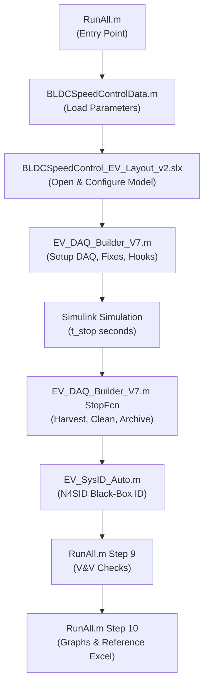

# EV Digital Twin — Baseline Inventory & Provenance Document

**Document Version:** 1.0  
**Date Generated:** 22-Oct-2026  
**Auditor:** AI V&V Engineer  
**Primary Baseline Run:** `EV_RUN_20261021_161504` (Stop Time 0.40 s)  
**Comparison Run:** `EV_RUN_20261021_172910` (Stop Time 0.20 s)  
**Reference Master:** `EV_DAQ_Clean_4_05_Reference_Master.xlsx` (0.50 s)  

---

## 1. Repository Structure

```
EV_DigitalTwin/
├── +Batteries2/                          ← Generated Simscape Battery ECM package
│   ├── +Modules/ModuleType1.ssc          ← 13S module (builds 13 series cells)
│   └── +ParallelAssemblies/
│       └── ParallelAssemblyType1.ssc     ← 10-parallel assembly (10 cells per module)
├── BLDCSpeedControl_EV_Layout_v2.slx     ← Main plant + control model (153 kB)
├── BLDCSpeedControlData.m                ← Master parameter script (motor, battery, control, drivetrain)
├── BLDCSpeedControlInput.mat             ← Signal Editor load profile (Test_1)
├── Batteries2.slx                        ← Battery pack top-level model (270 kB)
├── Batteries2_lib.slx                    ← Battery library with ModuleType1 mask (39 kB)
├── Datasheets_and_Simulation_Verification/
│   ├── APBA80L048030-E_Datasheet.pdf     ← Nanotec motor datasheet
│   ├── APBA80L048030-E_Manual_Description.pdf
│   ├── Samsung_INR21700-50E_Cell_Datasheet.pdf
│   ├── Datasheet_vs_Simulation_Values.xlsx
│   ├── Motor_Datasheet_Verification_Plot.png
│   ├── README.md
│   └── simulation_graphs/                ← Graphs from EV_RUN_20261021_172910
├── docs/
│   ├── EVTWIN_Project_Report.docx        ← Project technical report v1.0
│   └── Reference_Research_Papers/
│       └── EV_DAQ_Clean_4_05_Reference_Master.xlsx  ← 0.5s reference
├── EV_BatteryCheck.m                     ← Battery consistency check script
├── EV_BlackBox_SysID.mat                 ← **DEFECTIVE** legacy SysID model (ISSUE-06)
├── EV_CrossVerification_Results.xlsx     ← 102-row cross-verification dataset
├── EV_DAQ_Builder_V7.m                   ← 4350-line DAQ engine + V&V (237 kB)
├── EV_Digital_Twin_COMPLETE_ROOT_CAUSE_AUDIT.md  ← This audit report
├── EV_Digital_Twin_ROOT_CAUSE_REGISTER.xlsx      ← Issue register (11 issues)
├── EV_LastStopTime.txt                   ← Last stop time used (0.2)
├── EV_SysID_Auto.m                       ← Corrected N4SID identification script
├── EV_Twin_App.m                         ← MATLAB App Designer twin UI
├── RunAll.m                              ← One-click test runner (459 lines)
├── Simulation Logs/
│   ├── EV_RUN_20261021_154854/           ← Earlier run
│   ├── EV_RUN_20261021_155411/
│   ├── EV_RUN_20261021_160645/
│   ├── EV_RUN_20261021_161504/           ← ★ PRIMARY BASELINE (0.40 s)
│   │   ├── 01_EV_Run_Summary.xlsx
│   │   ├── 02_Parameters_and_Setup.xlsx
│   │   ├── 03_Cleaned_Data.xlsx
│   │   ├── 04_VV_Results.xlsx
│   │   ├── 05_Signal_Map.xlsx
│   │   ├── 06_Logging_Audit.xlsx
│   │   ├── 07_Group_Summary.xlsx
│   │   ├── 08_Event_Log.xlsx
│   │   ├── 09_Performance_Report.xlsx
│   │   ├── 10_Command_Log.txt
│   │   ├── 10_Compression_Audit.xlsx
│   │   ├── 11_Live_Telemetry.xlsx
│   │   ├── 11_Simulation_Log.txt
│   │   ├── 12_Cell_Diagnostics.xlsx
│   │   ├── EV_BlackBox_SysID.mat          ← Updated SysID model (this run)
│   │   ├── EV_BlackBox_SysID_Report.txt
│   │   ├── EV_DAQ_Clean_6_04.csv
│   │   ├── EV_DAQ_Clean_6_04.mat
│   │   ├── EV_Master_Data.xlsx
│   │   ├── EV_SysID_Checks.csv
│   │   ├── Figures/ (Battery_MASTER, Motor_MASTER, Combined_MASTER + 9 plots)
│   │   └── Raw_Archive/
│   ├── EV_RUN_20261021_171122/
│   └── EV_RUN_20261021_172910/           ← SHORT-RUN COMPARISON (0.20 s)
├── ex/                                   ← Example/utility scripts
├── old_backup/                           ← Pre-DAQ model backups
├── results/                              ← RunAll logs (99 files, multiple iterations)
├── scratch/
├── slprj/                                ← Simulink cache
└── website/                              ← Web dashboard data export
```

---

## 2. Execution Pipeline



### Signal Flow (Plant Model):
```
Battery Pack (13S10P) → DC-DC Buck Converter → DC Bus → 3-Phase BLDC Inverter
→ BLDC Motor (4 pole pairs, 120° Hall) → Gearbox (11:1) → Wheel/Vehicle Load
```

### Data Acquisition Pipeline:
1. **Raw signals** logged at 10 µs (40,001 samples for 0.4 s)
2. **Cleaned data** resampled to 1 ms common time base (401 samples)
3. **EV_BlackBox_log** at 1 ms ZOH (8 channels: Vbatt, Ibatt, SOC, RPM, Idc_f, Vdc_m, ω_wheel, Torque)
4. **SysID** splits 70/30 estimation/validation, runs N4SID order sweep 1–6
5. **V&V** runs 25+ automated checks with PASS/WARN/FAIL verdicts

---

## 3. Component Provenance Matrix

| Component | Source | Version / Build Date | Provenance Notes |
|---|---|---|---|
| MATLAB | MathWorks | R2024b Update 9 (24.2.0.3212159) | Platform verified |
| Simulink Model | MathWorks BLDC example + custom EV extensions | Modified 21-Oct-2026 | MD5: C54C659... |
| Battery Pack (+Batteries2) | Simscape Battery Builder R2024b | Generated 29-Sep-2026 | 13S10P, 130 individual cell models |
| Motor Datasheet | Nanotec Electronic GmbH | APBA80L048030-E(B) | Downloaded, verified |
| Cell Datasheet | Samsung SDI | INR21700-50E | Downloaded, verified |
| Control Gains | Manually tuned | V7 iteration (Oct 2026) | Kpw=0.05, Kiw=10, Kpi=0.2, Kii=100 |
| Load Profile | BLDCSpeedControlInput.mat | Test_1 | 0→3.18 N·m ramp 0.23–0.28 s |

---

## 4. Historical Run Registry

| Run ID | Stop Time | Cleaned Samples | Final RPM | SysID Available | V&V Status |
|---|---|---|---|---|---|
| EV_RUN_20261021_154854 | ? | ? | ? | ? | ? |
| EV_RUN_20261021_155411 | ? | ? | ? | ? | ? |
| EV_RUN_20261021_160645 | ? | ? | ? | ? | ? |
| **EV_RUN_20261021_161504** | **0.40 s** | **401** | **2950.44** | **Yes (nx=2, FAIL)** | **FAIL** |
| EV_RUN_20261021_171122 | ? | ? | ? | ? | ? |
| **EV_RUN_20261021_172910** | **0.20 s** | **201** | **2583** | **No** | **FAIL** |

> **Note:** Runs earlier than `_161504` were not audited in this session. Their data is preserved in `Simulation Logs/` but parameters and model version may differ.

---

## 5. Known Deficiencies in Baseline (Summary)

| Issue ID | Category | Severity | Status |
|---|---|---|---|
| ISSUE-01 | Motor Back-EMF Scaling (κ=0.72) | Critical | **Confirmed Fix** |
| ISSUE-02 | Acceleration Ramp Exceeds I_cont | Medium | **Open** |
| ISSUE-03 | Load Settling Truncation | Medium | **Open** |
| ISSUE-04 | Short-Run False Failures | Low | **Open** |
| ISSUE-05 | DC-Link Current is Estimate, Not Sensor | Low | **Known Assumption** |
| ISSUE-06 | Legacy SysID Model Duplicates RPM I/O | Medium | **Confirmed Fix (in EV_SysID_Auto.m)** |
| ISSUE-07 | SysID compare() Argument Bug | Critical | **Confirmed Fix** |
| ISSUE-08 | Battery R0 Underestimation (27 Ah template) | Medium | **Open Modeling Gap** |
| ISSUE-09 | Missing rpm_ref and temperature logging | Low | **Known Limitation** |
| ISSUE-10 | Digital Twin Classification (Level 2 only) | Informational | **Future Work** |
| ISSUE-11 | Motor Rs Mismatch (0.1Ω vs 0.0215Ω) | Medium | **Open Parameter Gap** |

---

## 6. Companion Files

| File | Description |
|---|---|
| `BASELINE_FILE_MANIFEST.csv` | MD5 hashes, sizes, timestamps for all critical files |
| `BASELINE_RUN_CONFIGURATION.txt` | Complete parameter dump and output metrics |
| `EV_Digital_Twin_COMPLETE_ROOT_CAUSE_AUDIT.md` | Full forensic audit report (Rev 2.0) |
| `EV_Digital_Twin_ROOT_CAUSE_REGISTER.xlsx` | Structured issue register (11 issues) |
